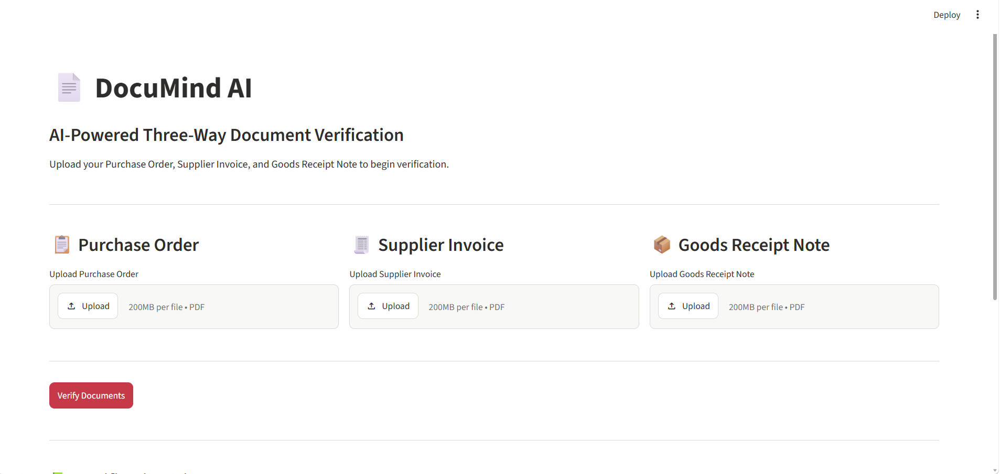

# DocuMind AI

### AI-Powered Three-Way Procurement Document Verification

DocuMind AI is a Python-based application that uses a locally hosted large language model to extract, validate, and compare procurement documents.

The system processes Purchase Orders (PO), Supplier Invoices, and Goods Receipt Notes (GRN) to identify quantity discrepancies, price mismatches, missing products, and potential financial differences.

Built as a practical GenAI portfolio project, DocuMind AI combines document processing, AI-assisted structured extraction, source grounding, rule-based verification, financial analysis, and automated reporting.

## Application Screenshot



## Key Features

- **Three-Way Document Verification:** Compares Purchase Orders, Supplier Invoices, and Goods Receipt Notes.
- **AI-Assisted Data Extraction:** Uses Ollama with Llama 3.2 3B to extract structured document information.
- **PDF and OCR Processing:** Extracts text from supported digital and scanned PDFs.
- **Extraction Accuracy Checks:** Validates extracted document identifiers, product details, quantities, and prices against source text.
- **Source Grounding:** Checks whether extracted values are supported by the original document.
- **Discrepancy Detection:** Identifies quantity mismatches, price differences, missing products, and unexpected invoice items.
- **Financial Analysis:** Calculates invoice values, received values at PO prices, and financial differences where sufficient data is available.
- **Missing-Value Handling:** Identifies products whose financial differences cannot be calculated instead of treating unavailable values as zero.
- **Analytics Dashboard:** Displays verification summaries, product status, and financial difference charts.
- **Report Generation:** Exports verification results as PDF, CSV, and JSON.
- **Verification History:** Stores completed verification records in SQLite and warns about previously verified invoice numbers.
- **Automated Testing:** Includes pytest tests for extraction validation, source grounding, and document verification.

## Technology Stack

| Category | Technology |
|---|---|
| Programming Language | Python 3.13 |
| Web Interface | Streamlit |
| Large Language Model | Llama 3.2 3B |
| Local LLM Runtime | Ollama |
| PDF Processing | PyMuPDF |
| OCR | Tesseract, Pytesseract |
| Data Validation | Pydantic |
| Data Processing | Pandas |
| Visualization | Matplotlib |
| Database | SQLite |
| PDF Report Generation | ReportLab |
| Automated Testing | Pytest |

## How It Works

1. **Upload Documents:** Upload a Purchase Order, Supplier Invoice, and Goods Receipt Note.
2. **Extract Text:** Extract document text using PDF processing and OCR where needed.
3. **AI Extraction:** Use the local LLM to produce structured document information.
4. **Validate Extraction:** Check extracted values against the original document text.
5. **Verify Documents:** Compare products, quantities, and unit prices across the three documents.
6. **Analyze Differences:** Calculate financial comparison metrics for products with sufficient information.
7. **Review Results:** View mismatches, analytics, and product-level details.
8. **Export Reports:** Download verification results in PDF, CSV, or JSON format.

## Installation

### 1. Clone the Repository

```powershell
git clone https://github.com/jeikishore222/Documind-AI.git
cd Documind-AI
```

### 2. Create a Virtual Environment

Install Python 3.13, then run:

```powershell
py -3.13 -m venv .venv
.\.venv\Scripts\Activate.ps1
```

### 3. Install Dependencies

```powershell
python -m pip install -r requirements.txt
python -m pip install pytest
```

### 4. Install and Configure Ollama

Download Ollama from:

https://ollama.com

Pull the required model:

```powershell
ollama pull llama3.2:3b
```

Ensure Ollama is running locally at:

`http://localhost:11434`

### 5. Install Tesseract OCR

Install Tesseract OCR and configure its executable path or system PATH so that the application can access it.

## Run the Application

```powershell
python -m streamlit run app.py
```

Open the local URL shown in the terminal.

Upload the three procurement PDFs and click **Verify Documents**.

## Run Automated Tests

```powershell
python -m pytest core/tests -v
```

Latest tested result:

**34 tests passed.**

## Project Structure

```text
Documind-AI/
|-- app.py
|-- core/
|   |-- column_layout.py
|   |-- extraction_checker.py
|   |-- llm_extractor.py
|   |-- ocr_processor.py
|   |-- schemas.py
|   |-- source_grounding.py
|   |-- verifier.py
|   `-- tests/
|-- database/
|   `-- db_manager.py
|-- reports/
|   `-- report_generator.py
|-- screenshots/
|   `-- dashboard.png
|-- requirements.txt
|-- .gitignore
`-- README.md
```

## Testing and Validation

DocuMind AI has been evaluated using automated tests and synthetic procurement document datasets.

### Automated Testing

The project passed **34 pytest tests**, covering:

- Quantity and unit-price validation
- Quantity-first and price-first table layouts
- Missing or unsupported column headers
- Incorrect document identifiers
- Duplicate product codes
- Goods Receipt Notes with unavailable price fields
- Source-grounding checks
- Missing products across procurement documents
- Three-way verification mismatch scenarios

### End-to-End Document Testing

**8-Product Benchmark**

- Total products: 8
- Matched products: 4
- Mismatched products: 4
- Invoice total: INR 20,735

**Layout B Benchmark**

- Total products: 11
- Matched products: 5
- Mismatched products: 6
- Invoice total: INR 248,600
- Net financial difference for calculable products: INR 27,600
- Products with unavailable financial differences: 3

The Layout B results were independently compared against the source Purchase Order, Supplier Invoice, and Goods Receipt Note.

These results demonstrate successful processing of the tested datasets, but do not guarantee accuracy across all document formats.

## Financial Calculation Method

For products with the necessary values:

**Invoice Value**

`Invoiced Quantity x Invoice Unit Price`

**Received Value at PO Price**

`Received Quantity x Purchase Order Unit Price`

**Financial Difference**

`Invoice Value - Received Value at PO Price`

The dashboard reports the signed sum of calculable product differences.

Products with unavailable financial differences are identified separately.

These calculations are comparison metrics, not final payable amounts.

## Limitations

- Extraction accuracy depends on document layout, OCR quality, and model output.
- Not every vendor-specific or complex PDF format is supported.
- Some financial differences cannot be calculated when required document values are missing.
- Taxes, discounts, and contractual adjustments are not included in the current financial comparison.
- AI-generated information and verification results should be reviewed before financial or operational decisions.

## Privacy

DocuMind AI uses a locally hosted Ollama model and stores verification history in a local SQLite database.

Users should avoid committing confidential procurement documents, database files, credentials, or generated reports to public repositories.

## Project Status

**Working portfolio implementation.**

Implemented functionality includes AI-assisted document extraction, source-grounding checks, three-way verification, financial discrepancy analysis, analytics, reporting, verification history, and automated tests.

The project has passed 34 automated tests and completed end-to-end validation on the documented synthetic benchmarks.

## Author

**Jeikishore K**

GitHub: https://github.com/jeikishore222
